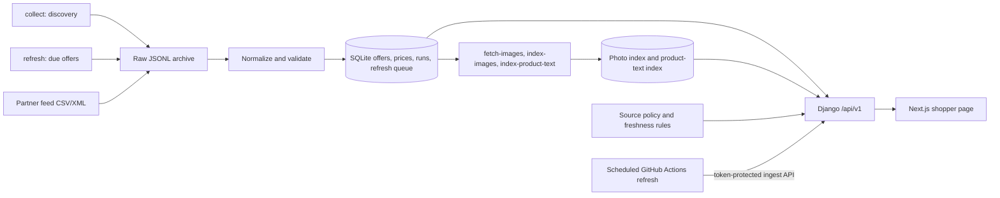

# Fashion Finder

Fashion Finder is a local-first clothing discovery app for Hungarian shops. It
combines a polite product collector, a Django catalogue API, and a responsive
Next.js shopper page with three ways to search: **words and filters**, **match by
look** (a description, in Hungarian or English, ranked against product photos),
and **photo search** (upload a photo, find similar items).

The repository is a working **local prototype**, not a public shopping service.
The default source policy publishes no offers: what a shop's products may show is
an owner decision recorded in `data/source-policies.json`. On 25 October 2026 a
local run collected 5,000 current offers from five Hungarian shops and indexed
1,500 of their photos for photo and look search; see
[run it on real products](#run-it-on-real-products-local-evaluation). Without
scraped data, the [practice catalogue](docs/practice-catalogue.md) loads about
3,600 licence-safe public-dataset products to exercise every search. The
[public Render demo](render.yaml) shows only a small synthetic catalogue.

## What it looks like

The page has a fashion-style landing section, a search form beside a photo
preview panel, and a grid of product cards. On a phone, those sections stack
vertically. Each card shows the shop, HUF price, last-checked date, stock claim,
match label, and a link to the retailer. An image placeholder appears when no
permitted product image is available.


[View the 390 px mobile screenshot](docs/images/shopper-mobile.png). Both
screenshots show **one synthetic local offer**. They do not show live retailer
coverage or grant permission to use retailer images.

## What a shopper can do

1. Search by words, category, colour, size, shop, and maximum HUF price, in
   Hungarian or English, with or without accents. `fekete kabát 30000 Ft alatt`
   fills the price limit; who an item is for (`női`, `men's`) ranks but never
   filters, because offers carry no gender field.
2. Tick **Match by look** to rank product photos by the description itself. The
   page shows how the query was read, for example "Searching for: black women's
   coat (from 'fekete női kabát')", plus price and size chips.
3. Upload a photo. The app focuses on the main garment automatically and draws
   the box it used, names what it saw ("Jacket · black"), offers other garments
   found in the photo, and lets you crop by hand or use the whole photo. Colour
   variants of one product fold into a "+N colours" badge.
4. Sort by price or last check and load more results. Each card shows the shop,
   HUF price, when the price was last checked (with a warning after 18 hours),
   and the stock claim. Similarity never implies an identical item: visual
   results are labeled **Style inspiration**.
5. Open the offer on the Hungarian retailer website to confirm final details.

No account, checkout, delivery estimate, stock guarantee, or price alert is
implemented. Search results come from stored catalogue data; a shopper request
never starts a retailer crawl.

## How it works



- **Collection:** `collect` discovers products on the shops marked `reviewed` in
  `src/fashion_finder_data/source_definitions.toml`; `refresh` re-checks known
  offers when they fall due, without crawling the whole site. Both honour
  robots.txt (including Crawl-delay), text-and-data-mining opt-outs and per-host
  pacing, send an honest `FashionFinderBot` User-Agent, and stop on 401/403 or a
  CAPTCHA instead of working around it. Partner feeds enter through `import-feed`.
  The [scraper guide](docs/scraper.md) covers sources, scheduling and reports.
- **Storage:** The pipeline preserves raw JSONL, normalizes records, deduplicates
  by source product ID or URL, and records price changes and run errors in
  SQLite. Django migrations upgrade an existing local catalogue.
- **Publication:** A default-deny source policy controls public listing and
  image use separately. The API hides prohibited, stale, out-of-stock,
  non-HUF, or invalid-Hungarian-link offers. Missing stock data stays unknown.
- **Search:** Django returns bounded, cursor-paged JSON. The web app sends
  search/filter requests through its same-origin API proxy and renders only API
  results. The API never exposes raw records or private policy evidence.
- **Operations:** Docker Compose runs migrations, Django/Gunicorn, Next.js, and
  the feed worker as separate processes. Optional anonymous analytics stores
  daily counters and removes rows older than 30 days.

### API routes

| Route | Purpose |
| --- | --- |
| `GET /api/v1/health` | Service status, latest catalogue timestamp, photo capability, analytics setting, and local demo mode. |
| `GET /api/v1/search` | Eligible offers with text, filters, sort, limit, and cursor. |
| `GET /api/v1/offers/{id}` | One current, permitted offer or 404. |
| `GET /api/v1/search/look` | Text-to-photo search; returns `interpreted_query` and `interpretation` (language, translation, colour, category, size, price limits). |
| `POST /api/v1/search/image` | Photo search over an explicitly enabled product-image index (or the five demo samples); returns what it understood in `query`. Uploads are limited to 5 MB and 2048×2048 px; the page re-encodes photos to 1024 px first. |
| `POST /api/v1/events` | Records coarse daily metrics only when analytics is enabled. |
| `GET /api/v1/ingest/due`, `GET /api/v1/ingest/known`, `POST /api/v1/ingest/offers` | Token-only API for a refresh runner (503 unless `FASHION_FINDER_INGEST_TOKEN` is set); never publishes by itself and refuses demo and practice rows. |

### Where the code lives

| Path | Responsibility |
| --- | --- |
| `web/app/`, `web/lib/` | Shopper page, photo crop and upload, look-search display. |
| `src/fashion_finder_data/collectors.py`, `discovery.py`, `structured_data.py`, `politeness.py` | Discovery crawls, schema.org and embedded-JSON extraction, robots and pacing. |
| `src/fashion_finder_data/source_definitions.toml`, `sources.py` | Every shop as validated configuration (hosts, start pages, sitemaps, status). |
| `src/fashion_finder_data/scheduler.py`, `runner.py`, `api/ingest.py` | Refresh queue, backoff, removal rules, and the API-mode runner. |
| `src/fashion_finder_data/image_fetch.py`, `image_index.py`, `query_understanding.py` | Photo download, photo index, garment focus and zero-shot reading. |
| `src/fashion_finder_data/text_match.py`, `hungarian.py`, `look_query.py`, `look_search.py`, `product_text.py` | Hungarian word handling, query reading, and look-search ranking. |
| `src/fashion_finder_data/practice/` | Licence-safe practice catalogue and the search benchmark. |
| `src/fashion_finder_data/feed.py`, `refresh.py` | Partner feed import and the scheduled feed worker. |
| `src/fashion_finder_data/schema.py`, `pipeline.py`, `storage.py` | Validation, normalization, raw archive, and SQLite writes. |
| `src/fashion_finder_data/public_catalogue.py`, `api/` | Policy-aware search and Django HTTP routes. |
| `src/fashion_finder_data/catalogue/` | Django models, migrations, and read-only staff admin. |
| `tests/`, `web/lib/*.test.ts`, `.github/workflows/ci.yml` | Regression checks and CI. |

### Run the app locally with Docker

From the repository root in Bash or WSL, with Docker Compose installed:

```bash
cp .env.example .env
python3 -c 'import secrets; print("FASHION_FINDER_SECRET_KEY=" + secrets.token_urlsafe(48))' >> .env
mkdir -p data/feeds
cp config/source-policies.example.json data/source-policies.json
docker compose up --build -d
docker compose ps
curl -fsS http://127.0.0.1:8000/api/v1/health
```

Open **http://localhost:3000**. The API listens on
**http://127.0.0.1:8000**. Both ports bind to loopback. On Linux or WSL, set
`FASHION_FINDER_UID` and `FASHION_FINDER_GID` in `.env` to `id -u` and `id -g`
if they differ from 1000. Keep `.env` and the source policy private.

The example policy is deliberately **pending**, so a fresh install shows an
empty catalogue. Do not mark a shop approved merely to fill the UI; approving
for local evaluation is a separate, recorded owner decision (next section). Follow the
[local Docker runbook](docs/local-docker-runbook.md) to import a permitted feed,
inspect worker logs, back up SQLite, and check the app. The
[local Python/Node setup](docs/app-local-setup.md) covers development without
Docker.

For a populated **synthetic local demo**, run `bash scripts/start_local_demo.sh`
and open `http://127.0.0.1:3300`. The [demo guide](docs/local-demo.md) explains
its separate database, sample labels, and limits. Demo products never count
toward the real-source release gates.

## Run it on real products (local evaluation)

These are the steps of the 25 October 2026 run, from the repository root in Bash
or WSL. Times are what that run took on a laptop.

```bash
python3.12 -m venv .venv && .venv/bin/pip install -e '.[dev,image-model]'
.venv/bin/fashion-finder --data-dir data migrate

# 1. Collect (about 7 minutes: 137 requests, at least 10 s apart per shop)
.venv/bin/fashion-finder --data-dir data collect all --all-categories \
  --limit 1000 --max-requests 40 --time-budget-minutes 30
```

**2. Decide what may be shown.** Copy `config/source-policies.example.json` to
`data/source-policies.json`. For each shop you choose to show, set
`approval_status` to `approved`, the three `allow_*` flags to `true`, and an
`evidence_ref` that records the decision honestly, for example `"local evaluation
only: owner decision 2026-10-25; not for public deployment"`. Collecting data is
not permission to publish it: never deploy a policy approved this way. A public
deployment needs real permission or an affiliate feed per shop.

```bash
# 3. Photos: one per offer, shops taken in turn. Most image hosts ask for
#    10 s between requests, so 1,500 photos took about 50 minutes.
.venv/bin/fashion-finder --data-dir data fetch-images \
  --policy data/source-policies.json --limit 1500 --per-offer 1

# 4. Models: the pinned INT8 Marqo-FashionSigLIP files (links and SHA-256 values
#    in docs/local-image-index.md) saved as:
#    data/models/fashion-siglip-vision-int8.onnx, data/models/fashion-siglip-text-int8.onnx,
#    data/models/fashion-siglip-tokenizer.json

# 5. Indexes (about 9 minutes for 1,500 photos, then about 1 minute)
M=data/models
.venv/bin/fashion-finder --data-dir data index-images data/images/manifest.json \
  --policy data/source-policies.json --model-path $M/fashion-siglip-vision-int8.onnx
.venv/bin/fashion-finder --data-dir data index-product-text \
  --policy data/source-policies.json --model-path $M/fashion-siglip-vision-int8.onnx \
  --text-model-path $M/fashion-siglip-text-int8.onnx \
  --tokenizer-path $M/fashion-siglip-tokenizer.json

# 6. API on 127.0.0.1:8000
FASHION_FINDER_SECRET_KEY=$(python3 -c 'import secrets; print(secrets.token_urlsafe(48))') \
FASHION_FINDER_DB=$PWD/data/fashion_finder.sqlite \
FASHION_FINDER_SOURCE_POLICIES=$PWD/data/source-policies.json \
FASHION_FINDER_IMAGE_SEARCH_EXPERIMENT=1 \
FASHION_FINDER_IMAGE_MODEL_PATH=$PWD/$M/fashion-siglip-vision-int8.onnx \
FASHION_FINDER_TEXT_MODEL_PATH=$PWD/$M/fashion-siglip-text-int8.onnx \
FASHION_FINDER_TOKENIZER_PATH=$PWD/$M/fashion-siglip-tokenizer.json \
.venv/bin/python manage.py runserver 127.0.0.1:8000

# 7. Shopper page on http://localhost:3000 (second terminal, Node 22 or newer)
cd web && npm ci
FASHION_FINDER_API_INTERNAL_URL=http://127.0.0.1:8000 npx next dev -p 3000 -H 127.0.0.1
```

`GET /api/v1/health` should report `"image_search": "available"` and
`"text_to_image": "available"`. Next.js 16.4.0 may stop once on the first `next dev`
or `next build` to print a security notice; run the command again. `npm audit`
reports critical advisories fixed in 16.4.3, so upgrade before any public
deployment. To keep the data fresh, run `fashion-finder --data-dir data refresh`
(see the [scraper guide](docs/scraper.md)); rerun `fetch-images` and both index
commands afterwards so new offers get photos.

## Practice catalogue (no scraping)

`fashion-finder --data-dir <empty dir> load-practice-catalogue <practice dir>`
loads about 3,600 public-dataset products (ABO, CC BY 4.0; GLAMI-1M, Apache-2.0)
into their own data directory, never next to real data, so every search can be
tried and measured before retailers are approved. Building the practice folder,
loading it and running the page are described in the
[practice catalogue guide](docs/practice-catalogue.md); measured results for
every search option are in [benchmark results](docs/benchmark-results.md).

## Data coverage and release state

**Local run, 25 October 2026.** `collect all --all-categories --limit 1000`
stored 1,000 current offers from each reviewed shop (Reserved, Sinsay, Mohito,
House, Cropp) with no rejected records: every offer has a HUF price, photo URL,
colour and sizes. Categories covered sweaters, tops, jeans, trousers, jackets,
coats and dresses; 9 % had no mapped category, and the curated lists do not yet
include shirts, skirts, shoes, bags or accessories. Cropp's women's shorts
category answered 404 and was removed from the configuration. The policies for
these shops remain **pending** in the repository:
the local run was approved for local evaluation only.

Earlier checks: Zara and Pull&Bear did not yield usable live product data, and
H&M returned HTTP 403. Most large Hungarian shops block or challenge crawlers,
need JavaScript, or opt out of AI crawling; the
[candidate list](docs/hungarian-source-candidates.md) records each one and why.
ABOUT YOU and Answear advertise affiliate feeds, the better route for them:
publisher access, feed samples, and image-use terms are still needed.

A private beta needs two approved sources with at least 100 current offers in
one category, 30 manually checked offers per source, 30 consented shopping
tasks with at least 24 successful, permitted image relevance evidence, and a
live source-to-browser test. The [application progress](docs/application-progress.md)
tracks the implemented work and open gates. The [release handoff](docs/release-gate-handoff.md)
lists the exact outstanding evidence. The [partner access handoff](docs/partner-access-handoff.md)
and [shopper research handoff](docs/shopper-research-handoff.md) provide the
operator steps. The [task evaluation guide](docs/task-evaluation-guide.md)
describes how to record real-user results and replay text/photo rankings.
Private task inputs stay outside Git; the report excludes queries and photos.

## Collection tools and source status

- **Scrapy:** discovery (`collect`) and refresh (`refresh`) with RFC 9309 robots
  handling, Crawl-delay, per-host pacing and stops on 401/403 or a CAPTCHA. Five
  LPP shops (Reserved, Sinsay, Mohito, House, Cropp) are `reviewed` and work; a
  shop that publishes schema.org product data can be added as configuration.
  `benchmark-extraction` classifies a shop's extraction method and timing.
- **Scheduled refresh:** `.github/workflows/fashion-finder-refresh.yml` runs at
  08:17 and 20:17 Budapest time and posts results to the token-protected ingest
  API. It skips until the `FASHION_FINDER_API_URL` and `FASHION_FINDER_API_TOKEN`
  secrets exist and the API has a persistent database; the free Render demo's
  database is temporary. The same command runs as a Render cron job or on a
  self-hosted runner ([scraper guide](docs/scraper.md)).
- **Playwright:** optional Chromium rendering, used only for shops marked as
  needing JavaScript. It does not guarantee access to a blocked storefront.
- **Crawlee:** compared with Scrapy on a local fixture; it is not required at
  runtime.
- **Feeds:** local CSV imports support all six source keys. ABOUT YOU and
  Answear are feed-only candidates with a dry-run validator and configurable
  local XML-to-CSV conversion; publisher access, the actual field mapping, and
  rights remain pending.

See the [source and licence review](docs/source-review.md),
[live source checks](docs/live-source-status.md), and
[remaining source decisions](docs/remaining-roadmap-decisions.md). The
[data research and plan](docs/data-research/README.md) sizes the working shops,
surveys new Hungarian shops, compares affiliate feed routes and lists licence-safe
test datasets.

## Ingestion pipeline in detail

1. Collect a small batch from one source.
2. Save raw source output to `data/raw/` as JSONL.
3. Normalize to the shared schema.
4. Validate fields and flag missing or malformed data.
5. Deduplicate by source plus source product ID/URL.
6. Upsert offers into local SQLite and append price observations.
7. Export normalized results and a collection-run report.

See the [architecture](docs/architecture.md), [data schema](docs/data-schema.md),
[pipeline roadmap](docs/roadmap.md), and [application implementation plan](docs/application-implementation-plan.md)
for the full contracts and delivery sequence.

## Development stack and checks

- Python 3.12
- Scrapy (robots-aware HTTP collection)
- Playwright for Python (optional Chromium rendering in the collector and diagnostics)
- Pydantic for schema validation
- Django ORM and migrations with SQLite for local persistence, API, and catalogue review
- Next.js and TypeScript for the shopper page
- Optional ONNX Runtime with pinned local Marqo-FashionSigLIP vision and text models
  (INT8 by default), an optional pinned opus-mt-hu-en translator, and a ViT baseline
- Docker Compose, Gunicorn, and WhiteNoise for local deployment
- JSONL for raw snapshots and portable exports
- Pytest, Ruff, ESLint, and TypeScript checks

GitHub Actions runs the Python and web checks and builds both Docker images on
pushes and pull requests. Local Python checks:

```powershell
python -m pytest
python -m ruff check .
python -m ruff format --check .
```

Existing SQLite catalogues are adopted by `fashion-finder migrate`; see the
[local app setup](docs/app-local-setup.md) before starting a development server.

## Windows quick start

```powershell
py -3.12 -m venv .venv
.\.venv\Scripts\Activate.ps1
python -m pip install --upgrade pip
pip install -e ".[dev]"
# Required for --browser collection and browser diagnostics
python -m playwright install chromium
```

From the repository root, try one bounded Reserved sample:

```powershell
fashion-finder sources list
fashion-finder collect reserved --limit 1
fashion-finder collect all --limit 1
fashion-finder collect reserved --limit 3 --url https://www.reserved.com/hu/hu/noi/ruhak
fashion-finder collect sinsay --limit 300
fashion-finder collect cropp --limit 500 --url https://www.cropp.com/hu/hu/ferfi/ruhazat/farmerek
fashion-finder collect zara --browser --limit 3
fashion-finder collect hm --browser --limit 3
fashion-finder collect pullandbear --browser --limit 3
fashion-finder report <run-id>
fashion-finder export data/exports/catalogue.csv
```

`collect all` runs only the sources marked `reviewed` in `source_definitions.toml` (today the five LPP shops); every other source needs an explicit name. It reports each retailer independently and exits nonzero when any source fails. Use `--url https://...` with a single source to test a specific Hungarian category or product URL. Only HTTPS pages on that retailer's Hungarian storefront are accepted. The CLI never logs in, solves CAPTCHAs, or works around HTTP 403. Requests identify themselves as `FashionFinderBot` with a contact URL (`--contact-url` or `FASHION_FINDER_CONTACT_URL`). Discovery (`collect`) and refresh of known offers (`refresh`) are separate commands; see [the scraper guide](docs/scraper.md).

`--browser` renders both category and product pages in Chromium before the existing
parsers run. Scrapy checks `robots.txt` before each top-level navigation. Its
ten-second request delay applies to those navigations; Chromium also loads page
assets such as scripts and images. The per-source product limit, local storage,
and run reports still apply. The collector waits
1.5 seconds for scripts after each navigation; adjust with `--browser-wait-ms 3000`
(0–10000) if a page renders slowly. Run each blocked source separately to see its
own report. Browser mode has not produced verified records for Zara, H&M, or
Pull&Bear; a browser may still receive HTTP 403 or pages without usable prices.

To check whether a normal Chromium browser can see one category without importing data,
run `python scripts/browser_diagnostic.py zara` after installing Chromium with
`python -m playwright install chromium`. Repeat with `hm` or `pullandbear`.
It reports the HTTP status and visible product link/price counts without importing
any records. A browser can render JavaScript, but it cannot guarantee access to
pages that return HTTP 403. The diagnostic uses no stealth settings.

Reserved, Sinsay, Mohito, House and Cropp run on one LPP storefront platform. Their
category pages embed the listed products with price, regular price, images, colour and
per-size stock, so collection stores offers straight from the listing without one
request per product. Listings are cumulative (`?page=N` repeats earlier pages), so the
collector jumps to the page that should cover `--limit`. On 2026-10-13, 300 Sinsay
jackets took three category requests (pages 1, 5 and 6), not 300 product requests. One product listed under alias URLs
(`coat-2-…`) is stored once, under its plain URL. Pages without the embedded listing
fall back to following product links.

Reserved recognizes the public `kabatok`, `ruhak`, and `puloverek` category paths as coats, dresses, and sweaters. For LPP category URLs, a final path word such as `dzsekik` or `farmerek` maps to its category; a path that names two categories, such as `dzsekik-kabatok`, stays unclassified. The H&M adapter can read complete HUF offers from category cards if the page is accessible, but the live Scrapy check here was blocked before parsing.

Every collection writes raw JSONL under `data/raw/<source>/`, a run report under `data/reports/`, offers and price changes in `data/fashion_finder.sqlite`, and refreshed JSONL/CSV exports under `data/exports/`. These local outputs are ignored by Git. Repeat runs update an offer and add a price observation only when its price or currency changes.

Search the stored HUF offers without making another retailer request:

```powershell
fashion-finder search --query dzseki --max-price 30000 --sort price-asc
fashion-finder search --query "fekete kabát" --sort relevance
fashion-finder search --category dresses --source reserved --sort recent --limit 10
```

Text search ignores accents and translates common clothing and colour words both ways,
so `black coat`, `fekete kabát` and `fekete kabat` find the same listings, Hungarian
or English. It matches title, brand, description, category and colour, word by word:
a word of four or more letters may start or end a longer word (`kabát` finds
`kabátok` and `gyapjúkabát`), while a shorter one must be a whole word, so `red` no
longer matches `Redőzött`. `--sort relevance` (the shopper page's **Best match**)
ranks title hits above category or colour hits, and exact words above partial ones.
The web colour filter works the same way (`blue` matches `sötétkék`), and a size
such as `M` matches a combined size like `M/L`.

Search pages use a keyset cursor: **Load more** continues after the last result
shown, even if that item has since sold out or changed price.

Search returns JSONL with source links, prices, category, image URLs, and last-seen time. The default currency is HUF; use `--currency` for another stored currency. Budget comparisons and price sorting use exact decimal values within one currency. Results reflect the last collection, so unknown stock remains `unknown`.

Known English and Hungarian category labels map to shared keys such as `coats`, `jackets`, `dresses`, `sweaters`, and `shirts`. The original label is kept as `source_category`. Unknown labels stay unclassified and appear in quality reports instead of being guessed. Opening an older SQLite database adds `source_category` and maps its existing category values once.

Check freshness and field quality by retailer and category:

```powershell
fashion-finder quality --stale-after-days 7
fashion-finder quality --output data/reports/quality-check.json
```

The report counts old observations, missing fields, unmapped categories, malformed stored values, and unknown availability. It does not contact retailers or change offer status. An old observation means the listing needs another check; it does not prove the item was removed or sold out. `--output` creates a new JSON file and refuses to overwrite an existing one.

List offers that need a direct check:

```powershell
fashion-finder recheck --source reserved --stale-after-days 7 --limit 20
```

This command is read-only. It includes a direct URL only when the stored URL still passes
the retailer and Hungarian-market checks. Missing items in a bounded sample and HTTP
errors do not mark offers unavailable. See the [source-specific removal policy](docs/remaining-roadmap-decisions.md#removal-and-stock-policy).

To replay a raw file without network access:

```powershell
fashion-finder ingest reserved data/raw/reserved/<run-id>.jsonl
```

If a retailer provides an authorized product export, import a local CSV:

```powershell
fashion-finder import-feed zara path/to/authorized-products.csv
fashion-finder validate-feed aboutyou path/to/mapped-aboutyou.csv
fashion-finder map-xml-feed aboutyou path/to/download.xml path/to/mapping.json path/to/mapped-aboutyou.csv --observed-at <ISO-8601-download-time>
```

The CSV needs `product_url,name,price,currency` headers. Optional headers are
`sku,brand,category,description,original_price,image_url,colour,size,availability`.
Use one product per row, a full HTTPS URL on that retailer's Hungarian storefront,
and `HUF` prices. The command reads a local file; it does not fetch a feed URL or
grant permission to collect retailer content. Valid rows enter the same raw archive,
database, exports, and run report as web collection. Invalid rows are counted and
reported; a partial import exits nonzero. Scheduled feeds and `validate-feed`
also require `observed_at` with a timezone. The dry-run validator writes no
database or raw archive. No partner feed for the candidate sources has been
provided or verified; see the [onboarding steps](docs/hungarian-source-candidates.md).

LPP sources page through a category until `--limit` is met. Other sources sample the first category page only. Neither covers a full catalogue unless you pass its categories with `--url`. The limit is 1–60,000 product offers per source across all starting URLs; `--max-requests` and `--time-budget-minutes` bound the actual work, and each host keeps at least a 10-second delay (longer when its robots.txt asks for it). A JSONL export contains product and image URLs, but this does not grant rights to republish retailer content or images.

## First success criteria

- Source inventory and code-licence decisions are documented.
- Fixture records can pass through normalization and validation.
- A small collector batch produces raw JSONL and normalized output.
- Repeat runs update existing offers rather than creating duplicates.
- Each run records item counts, failures and timestamps.
- Prices, currency and product URLs can be manually verified for a sample.

## Important boundaries

- Software licences cover source code, not retailer content collected through it.
- Public visibility does not itself grant permission to reuse source code.
- Site terms, content rights and source-specific limitations are separate from code licensing.
- Do not design collectors to bypass logins, CAPTCHAs, access controls, or explicit blocks.
- This is a local feasibility experiment; country coverage, freshness and output quality remain unverified until tested.
