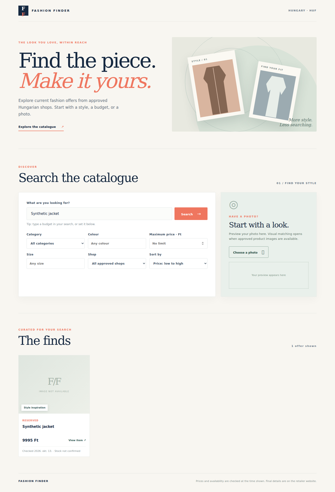
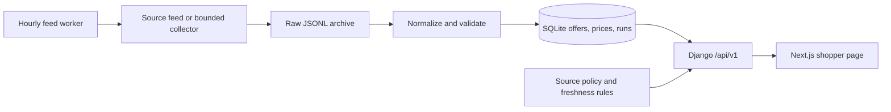

# Fashion Finder

Fashion Finder is a local-first clothing discovery app for Hungarian shops. It
combines a product collection pipeline, a Django catalogue API, and a responsive
Next.js shopper interface. The first usable flow is **text and filter search**
over offers that a source policy permits the app to publish.

The repository is a working **local prototype**, not a public shopping service.
The default source policy publishes no offers. Photo upload has a real preview.
The isolated demo compares five CC0 images by coarse colour and layout. An
[offline image-index experiment](docs/local-image-index.md) can use locally
supplied, policy-permitted feed photos with either the built-in descriptor or
an optional pinned pretrained ViT encoder. Real retailer photo search still
needs source rights and real-user relevance evaluation.

## What it looks like

The page has a fashion-style landing section, a search form beside a photo
preview panel, and a grid of product cards. On a phone, those sections stack
vertically. Each card shows the shop, HUF price, last-checked date, stock claim,
match label, and a link to the retailer. An image placeholder appears when no
permitted product image is available.



[View the 390 px mobile screenshot](docs/images/shopper-mobile.png). Both
screenshots show **one synthetic local offer**. They do not show live retailer
coverage or grant permission to use retailer images.

## What a shopper can do

1. Search by text, category, colour, size, shop, and maximum HUF price. For
   example, `black jacket under 15000 Ft` fills the price limit automatically.
2. Sort current eligible offers by price or last check, then load more results.
3. Review each offer's price, freshness, source, image availability, and stock
   state. Unknown stock is shown as unconfirmed. Similarity never implies an
   identical item: unverified results are labeled **Style inspiration**.
4. Open the offer on the Hungarian retailer website to confirm final details.
5. Select a JPEG, PNG, or WebP photo and see a local preview. In the isolated
   demo, compare it with five CC0 sample images. The regular app reports photo
   matching as unavailable until an approved image catalogue exists.

No account, checkout, delivery estimate, stock guarantee, or price alert is
implemented. Search results come from stored catalogue data; a shopper request
never starts a retailer crawl.

## How it works



- **Collection:** Scrapy can run small, robots-aware retailer checks. An
  authorized CSV feed can instead enter through `import-feed`. The scheduled
  worker watches timestamped CSV files for six configured source keys and
  imports changed files outside shopper requests.
- **Storage:** The pipeline preserves raw JSONL, normalizes records, deduplicates
  by source product ID or URL, and records price changes and run errors in
  SQLite. Django migrations upgrade an existing local catalogue.
- **Publication:** A default-deny source policy controls public listing and
  image use separately. The API hides prohibited, stale, out-of-stock,
  non-HUF, or invalid-Hungarian-link offers. Missing stock data stays unknown.
- **Search:** Django returns bounded, cursor-paged JSON. The web app sends
  search/filter requests through its same-origin API proxy and renders only API
  results. The API never exposes raw records or private policy evidence.
- **Operations:** Docker Compose runs migrations, Django/Gunicorn, Next.js, and
  the feed worker as separate processes. Optional anonymous analytics stores
  daily counters and removes rows older than 30 days.

### API routes

| Route | Purpose |
| --- | --- |
| `GET /api/v1/health` | Service status, latest catalogue timestamp, photo capability, analytics setting, and local demo mode. |
| `GET /api/v1/search` | Eligible offers with text, filters, sort, limit, and cursor. |
| `GET /api/v1/offers/{id}` | One current, permitted offer or 404. |
| `POST /api/v1/search/image` | Validates an uploaded image; matches the five demo samples or an explicitly enabled local product-image index; otherwise returns 503. |
| `POST /api/v1/events` | Records coarse daily metrics only when analytics is enabled. |

### Where the code lives

| Path | Responsibility |
| --- | --- |
| `web/app/` | Shopper page, responsive styling, and local photo preview. |
| `src/fashion_finder_data/collectors.py`, `feed.py`, `refresh.py` | Bounded collection, CSV import, and scheduled feed refresh. |
| `src/fashion_finder_data/schema.py`, `pipeline.py`, `storage.py` | Validation, normalization, raw archive, and SQLite writes. |
| `src/fashion_finder_data/public_catalogue.py`, `api/` | Policy-aware search and Django HTTP routes. |
| `src/fashion_finder_data/catalogue/` | Django models, migrations, and read-only staff admin. |
| `tests/`, `web/lib/*.test.ts`, `.github/workflows/ci.yml` | Regression checks and CI. |

### Run the app locally with Docker

From the repository root in Bash or WSL, with Docker Compose installed:

```bash
cp .env.example .env
python3 -c 'import secrets; print("FASHION_FINDER_SECRET_KEY=" + secrets.token_urlsafe(48))' >> .env
mkdir -p data/feeds
cp config/source-policies.example.json data/source-policies.json
docker compose up --build -d
docker compose ps
curl -fsS http://127.0.0.1:8000/api/v1/health
```

Open **http://localhost:3000**. The API listens on
**http://127.0.0.1:8000**. Both ports bind to loopback. On Linux or WSL, set
`FASHION_FINDER_UID` and `FASHION_FINDER_GID` in `.env` to `id -u` and `id -g`
if they differ from 1000. Keep `.env` and the source policy private.

The example policy is deliberately **pending**, so a fresh install shows an
empty catalogue. Do not mark a shop approved merely to fill the UI. Follow the
[local Docker runbook](docs/local-docker-runbook.md) to import a permitted feed,
inspect worker logs, back up SQLite, and check the app. The
[local Python/Node setup](docs/app-local-setup.md) covers development without
Docker.

For a populated **synthetic local demo**, run `bash scripts/start_local_demo.sh`
and open `http://127.0.0.1:3300`. The [demo guide](docs/local-demo.md) explains
its separate database, sample labels, and limits. Demo products never count
toward the real-source release gates.

## Data coverage and release state

Reserved Hungary produced 13 bounded live sample offers on 12 October 2026,
including 10 checked against product pages. That is extraction evidence, not
an approved production catalogue. Zara and Pull&Bear did not yield usable live
product data in the documented checks; H&M returned HTTP 403. ABOUT YOU and
Answear Hungary advertise affiliate feeds, but they are [candidates](docs/hungarian-source-candidates.md):
publisher access, feed samples, and image-use terms are still needed.

A private beta needs two approved sources with at least 100 current offers in
one category, 30 manually checked offers per source, 30 consented shopping
tasks with at least 24 successful, permitted image relevance evidence, and a
live source-to-browser test. The [application progress](docs/application-progress.md)
tracks the implemented work and open gates. The [release handoff](docs/release-gate-handoff.md)
lists the exact outstanding evidence. The [partner access handoff](docs/partner-access-handoff.md)
and [shopper research handoff](docs/shopper-research-handoff.md) provide the
operator steps. The [task evaluation guide](docs/task-evaluation-guide.md)
describes how to record real-user results and replay text/photo rankings.
Private task inputs stay outside Git; the report excludes queries and photos.

## Collection tools and source status

- **Scrapy:** bounded public-page collection with robots checks and conservative
  request pacing. The configured adapters are Zara, H&M, Reserved, and
  Pull&Bear. Only the small Reserved sample is documented as successful.
- **Playwright:** optional Chromium rendering and diagnostics for pages that
  need JavaScript. It does not guarantee access to a blocked storefront.
- **Crawlee:** compared with Scrapy on a local fixture; it is not required at
  runtime.
- **Feeds:** local CSV imports support all six source keys. ABOUT YOU and
  Answear are feed-only candidates with a dry-run validator and configurable
  local XML-to-CSV conversion; publisher access, the actual field mapping, and
  rights remain pending.

See the [source and licence review](docs/source-review.md),
[live source checks](docs/live-source-status.md), and
[remaining source decisions](docs/remaining-roadmap-decisions.md).

## Ingestion pipeline in detail

1. Collect a small batch from one source.
2. Save raw source output to `data/raw/` as JSONL.
3. Normalize to the shared schema.
4. Validate fields and flag missing or malformed data.
5. Deduplicate by source plus source product ID/URL.
6. Upsert offers into local SQLite and append price observations.
7. Export normalized results and a collection-run report.

See the [architecture](docs/architecture.md), [data schema](docs/data-schema.md),
[pipeline roadmap](docs/roadmap.md), and [application implementation plan](docs/application-implementation-plan.md)
for the full contracts and delivery sequence.

## Development stack and checks

- Python 3.12
- Scrapy (robots-aware HTTP collection)
- Playwright for Python (optional Chromium rendering in the collector and diagnostics)
- Pydantic for schema validation
- Django ORM and migrations with SQLite for local persistence, API, and catalogue review
- Next.js and TypeScript for the shopper page
- Optional ONNX Runtime and a pinned local ViT encoder for visual evaluation
- Docker Compose, Gunicorn, and WhiteNoise for local deployment
- JSONL for raw snapshots and portable exports
- Pytest, Ruff, ESLint, and TypeScript checks

GitHub Actions runs the Python and web checks and builds both Docker images on
pushes and pull requests. Local Python checks:

```powershell
python -m pytest
python -m ruff check .
python -m ruff format --check .
```

Existing SQLite catalogues are adopted by `fashion-finder migrate`; see the
[local app setup](docs/app-local-setup.md) before starting a development server.

## Windows quick start

```powershell
py -3.12 -m venv .venv
.\.venv\Scripts\Activate.ps1
python -m pip install --upgrade pip
pip install -e ".[dev]"
# Required for --browser collection and browser diagnostics
python -m playwright install chromium
```

From the repository root, try one bounded Reserved sample:

```powershell
fashion-finder sources list
fashion-finder collect reserved --limit 1
fashion-finder collect all --limit 1
fashion-finder collect reserved --limit 3 --url https://www.reserved.com/hu/hu/noi/ruhak
fashion-finder collect zara --browser --limit 3
fashion-finder collect hm --browser --limit 3
fashion-finder collect pullandbear --browser --limit 3
fashion-finder report <run-id>
fashion-finder export data/exports/catalogue.csv
```

`collect all` reports each retailer independently and exits nonzero when any source fails. Use `--url https://...` with a single source to test a specific Hungarian category or product URL. Only HTTPS pages on that retailer's Hungarian storefront are accepted. The CLI never logs in, solves CAPTCHAs, or works around HTTP 403.

`--browser` renders both category and product pages in Chromium before the existing
parsers run. Scrapy checks `robots.txt` before each top-level navigation. Its
ten-second request delay applies to those navigations; Chromium also loads page
assets such as scripts and images. The per-source product limit, local storage,
and run reports still apply. The collector waits
1.5 seconds for scripts after each navigation; adjust with `--browser-wait-ms 3000`
(0–10000) if a page renders slowly. Run each blocked source separately to see its
own report. Browser mode has not produced verified records for Zara, H&M, or
Pull&Bear; a browser may still receive HTTP 403 or pages without usable prices.

To check whether a normal Chromium browser can see one category without importing data,
run `python scripts/browser_diagnostic.py zara` after installing Chromium with
`python -m playwright install chromium`. Repeat with `hm` or `pullandbear`.
It reports the HTTP status and visible product link/price counts without importing
any records. A browser can render JavaScript, but it cannot guarantee access to
pages that return HTTP 403. The diagnostic uses no stealth settings.

Reserved recognizes the public `kabatok`, `ruhak`, and `puloverek` category paths as coats, dresses, and sweaters. Other Reserved category overrides retain an unknown category until mapped. The H&M adapter can read complete HUF offers from category cards if the page is accessible, but the live Scrapy check here was blocked before parsing.

Every collection writes raw JSONL under `data/raw/<source>/`, a run report under `data/reports/`, offers and price changes in `data/fashion_finder.sqlite`, and refreshed JSONL/CSV exports under `data/exports/`. These local outputs are ignored by Git. Repeat runs update an offer and add a price observation only when its price or currency changes.

Search the stored HUF offers without making another retailer request:

```powershell
fashion-finder search --query dzseki --max-price 30000 --sort price-asc
fashion-finder search --category dresses --source reserved --sort recent --limit 10
```

Search returns JSONL with source links, prices, category, image URLs, and last-seen time. The default currency is HUF; use `--currency` for another stored currency. Budget comparisons and price sorting use exact decimal values within one currency. Results reflect the last collection, so unknown stock remains `unknown`.

Known English and Hungarian category labels map to shared keys such as `coats`, `jackets`, `dresses`, `sweaters`, and `shirts`. The original label is kept as `source_category`. Unknown labels stay unclassified and appear in quality reports instead of being guessed. Opening an older SQLite database adds `source_category` and maps its existing category values once.

Check freshness and field quality by retailer and category:

```powershell
fashion-finder quality --stale-after-days 7
fashion-finder quality --output data/reports/quality-check.json
```

The report counts old observations, missing fields, unmapped categories, malformed stored values, and unknown availability. It does not contact retailers or change offer status. An old observation means the listing needs another check; it does not prove the item was removed or sold out. `--output` creates a new JSON file and refuses to overwrite an existing one.

List offers that need a direct check:

```powershell
fashion-finder recheck --source reserved --stale-after-days 7 --limit 20
```

This command is read-only. It includes a direct URL only when the stored URL still passes
the retailer and Hungarian-market checks. Missing items in a bounded sample and HTTP
errors do not mark offers unavailable. See the [source-specific removal policy](docs/remaining-roadmap-decisions.md#removal-and-stock-policy).

To replay a raw file without network access:

```powershell
fashion-finder ingest reserved data/raw/reserved/<run-id>.jsonl
```

If a retailer provides an authorized product export, import a local CSV:

```powershell
fashion-finder import-feed zara path/to/authorized-products.csv
fashion-finder validate-feed aboutyou path/to/mapped-aboutyou.csv
fashion-finder map-xml-feed aboutyou path/to/download.xml path/to/mapping.json path/to/mapped-aboutyou.csv --observed-at <ISO-8601-download-time>
```

The CSV needs `product_url,name,price,currency` headers. Optional headers are
`sku,brand,category,description,original_price,image_url,colour,size,availability`.
Use one product per row, a full HTTPS URL on that retailer's Hungarian storefront,
and `HUF` prices. The command reads a local file; it does not fetch a feed URL or
grant permission to collect retailer content. Valid rows enter the same raw archive,
database, exports, and run report as web collection. Invalid rows are counted and
reported; a partial import exits nonzero. Scheduled feeds and `validate-feed`
also require `observed_at` with a timezone. The dry-run validator writes no
database or raw archive. No partner feed for the candidate sources has been
provided or verified; see the [onboarding steps](docs/hungarian-source-candidates.md).

The first category page only is sampled; pagination and full-catalogue coverage are not implemented. The limit is 1–100 product offers per source across all starting URLs, with a 10-second per-domain delay. A JSONL export contains product and image URLs, but this does not grant rights to republish retailer content or images.

## First success criteria

- Source inventory and code-licence decisions are documented.
- Fixture records can pass through normalization and validation.
- A small collector batch produces raw JSONL and normalized output.
- Repeat runs update existing offers rather than creating duplicates.
- Each run records item counts, failures and timestamps.
- Prices, currency and product URLs can be manually verified for a sample.

## Important boundaries

- Software licences cover source code, not retailer content collected through it.
- Public visibility does not itself grant permission to reuse source code.
- Site terms, content rights and source-specific limitations are separate from code licensing.
- Do not design collectors to bypass logins, CAPTCHAs, access controls, or explicit blocks.
- This is a local feasibility experiment; country coverage, freshness and output quality remain unverified until tested.
